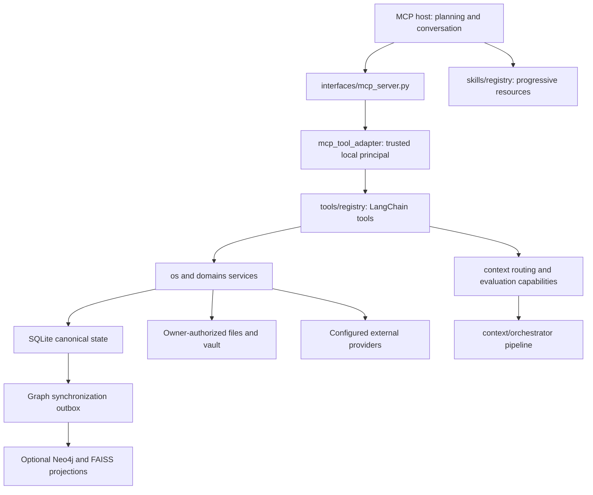

# Current architecture map

Newest verified boundaries2026-11-15: `mcp_server._mcp_lifespan` owns the existing
projection loop only when graph+worker flags are explicitly enabled. The loop
claims SQLite outbox work, fences acknowledgements and releases only undispatched
claims at shutdown. Configured/running/inflight state is additive in graph stats.
FAISS persists two checked index/map slots and one atomic current pointer;
canonical SQLite remains authoritative. Embedding identity and current text
fingerprints gate semantic fusion. Existing pure writing validators route as
READ through the same MCP gateway, not a bypass. Source/frozen-install runtime
and178 related tests pass; no new service, agent, storage engine or owner flag
change. Exact components/rollback are in Phase1/3; historical map below remains
dated evidence rather than a complete production-readiness claim.

Phase1 source update2026-11-14: `MCP STDIO → installation principal → packaged explicit tool policy → owner action policy → schema/key validation → SQLite gateway reservation → bounded domain invocation → typed/sanitized bounded result → stored replay`. This reuses the existing adapter/domain layer and existing tables. Unknown/FINAL policy is denied, and HTTP is disabled before initialization without independent authentication. The context executor also raises risk to canonical/selected-provider declarations and rejects changed-payload replay. Optional config overrides read the explicitly selected existing SQLite file in read-only mode and accept bounded tuning only. No new orchestrator, database or agent is introduced. Detailed contracts and remaining independent approval/direct-domain boundaries: [tool governance](../architecture/TOOL_GOVERNANCE.md).

Audit date: 2026-11-10. Baseline: `main` at `2d0f13f`, with preexisting owner changes preserved. This is a bounded source audit, not a production certification. `VERIFIED_CODE` means current source inspection; `VERIFIED_TEST` means an executed reproducible test; `VERIFIED_RUNTIME` means actual execution. Documentation and historical files do not establish runtime behavior.

## Observed execution paths

The context orchestrator is an available capability, not the common gate around every public MCP invocation. `mcp_tool_adapter.langchain_tool_as_mcp_callable` invokes `tool.ainvoke` directly. Domain tools may add their own gates. This distinction is `VERIFIED_CODE`; it does not prove every domain mutation is unsafe.

## Component responsibilities and ownership

All rows below are `VERIFIED_CODE` unless explicitly qualified. Paths refer to the repository root.

| Component | Actual responsibility | Dependencies | State | Evidence | Problem | Recommended action |
|---|---|---|---|---|---|---|
| MCP entrypoint | Register tools/resources/prompt; run STDIO or loopback Streamable HTTP | Python MCP SDK, migrations, adapter | Import-time DB initialization; process settings | `xninetzy/interfaces/mcp_server.py:18`, `:51`, `:133` | Import has persistence side effects; no transport conformance result here | Keep STDIO canonical; test startup with isolated paths; verify negotiated protocol before SDK upgrade |
| Host runtime mapping | Convert container paths for host execution | pathlib, dotenv | Process environment only | `interfaces/mcp_runtime.py:25`, `:137` under `xninetzy/` | Legacy path-depth assumption escaped flat checkout | Fixed and covered by 17 focused passing tests; preserve explicit paths and legacy layout; refuse implicit store switching |
| Principal injection | Replace client-supplied trusted fields for BaseTool calls | Settings, Pydantic tool schema | Immutable local-owner principal | `xninetzy/interfaces/mcp_tool_adapter.py:24`, `:282` | This represents installation identity, not independent HTTP user auth | Keep loopback boundary; audit any future remote authentication separately |
| Tool registry | Import canonical tool objects and organize groups | Broad domain import graph; `langchain_core` | Module globals/tool objects | `xninetzy/tools/registry.py`; `tools/manifest.py:64` | Eager imports and heuristic risk classification; metadata is not enforcement | Generate inventory from live objects, add explicit policy ownership incrementally |
| Action policy | Classify read/draft/write/final; select action mode and payload hash | Settings overrides | Configuration | `xninetzy/os/policy/action_policy.py:96`, `:149` | Name heuristics classify unknown names as write; explicit malformed side-effect classes now reject | Preserve stricter controls; bind operation risk independently of caller declarations |
| Context invocation gate | Filter provider trust, presence of idempotency and approval fields | Side-effect table, audit ledger | SQLite invocation records | `xninetzy/context/policy/gate.py`; `context/orchestrator/pipeline.py` | Malformed explicit classes now block; approval presence remains insufficient; omitted None keeps legacy read-only | Bind verified principal/action/payload/expiry and canonical operation risk |
| HITL approvals | Persist request, hash, expiry; authorize approve/reject; dispatch selected action types | SQLite, research permissions, selected domain services | `approval_requests` | `xninetzy/os/hitl/approval_service.py:17`, `:103`, `:166` | `validate_approval` has no consume transition or principal argument | Add atomic reservation/consumption and owner binding before claiming single use |
| Idempotency | Store/replay call results | SQLite | `idempotency_keys` | `xninetzy/db/idempotency.py` | Baseline pending reservations were executable by concurrent callers | See implementation batch/report for current fix; external uncertain delivery remains separate |
| Database | Canonical single-owner relational state and schema setup | stdlib SQLite | WAL, foreign keys enabled, tables in init/migrations | `xninetzy/db/sqlite.py:10`; `db/migrations.py` | Schema/constraint coverage remains bounded; controlled backup recovery is now tested | Map ownership before schema changes; no owner migration |
| Backup/restore | Online SQLite snapshot, strict v1 verification, safe retention, offline staged replacement and pre-restore capture | stdlib SQLite/files/POSIX lock; existing `scripts/xninetzy_backup.py` | Snapshot directories plus manifests; no new table | VERIFIED_TEST / VERIFIED_RUNTIME: `xninetzy/os/backup/service.py`,36 backup cases and installed-MCP drill | Offline owner coordination required; no atomic SQLite/FAISS group or external reconciliation guarantee | Keep services offline on interruption; preserve safety snapshot/journals; see [guide](../../apps/docs/src/pages/docs/backup-restore.md) |
| Workflow executor | Execute/resume exact ordered plans with versioned typed working checkpoints | `workflow/actions.py`, effective owner policy, notifier, store, POSIX file lock | Existing `workflow_runs.result_json`, `workflow_action_runs`; no migration | VERIFIED_TEST / VERIFIED_RUNTIME: `xninetzy/workflow/executor.py`, `store.py`;59 workflow cases plus installed-MCP smoke | General DAG/outcome verification, ambiguous external reconciliation and nonlocal/mixed-version locking remain open | RUNNING before effect; atomic short checkpoint commits; retain completed results; safe-read retry whitelist; hold uncertain mutation. See [contract](../architecture/AGENTIC_WORKFLOW.md) |
| Harness | Plan records, recorded actions, verification, recovery/checkpoint tools | SQLite migrations | `harness_plans`, actions, verifications | `xninetzy/tools/ecosystem/harness_tools.py:31`, `:83`, `:189`, `:436` | `harness_execute` marks progress; it is not a general autonomous execution loop | Keep as durable coordination records; avoid overstating executor capability |
| Research | Bounded light acquisition and deeper session engines | Source/action registries, configured web/academic/video providers | Research sessions, sources, briefs | `xninetzy/os/research/light_pipeline.py:12`; `tools/ecosystem/research_tools.py:61`; `db/migrations.py` | Light collection iterates sources sequentially; live availability/citation validity unknown | Measure provider failures/latency before fan-out changes; preserve snippet/full-text distinction |
| Knowledge retrieval | SQLite chunks/FTS5 plus optional FAISS; rank fusion; evidence bundle and answer finalization | Embeddings, vector store, model adapter | Knowledge sources/chunks, index files | `xninetzy/os/knowledge/vector_store.py:205`, `:230`; `knowledge/retrieval.py:85`, `:333` | No measured retrieval quality in this audit; index/map file writes are separate | Reuse existing RRF; evaluate exact/semantic/negative cases and interrupted saves before adding databases |
| Graph projection | Canonical SQLite/outbox; lease-bound execution/ACK and exact revision sync markers; optional Neo4j/FAISS | `graph/v3/sqlite_store.py`, neo4j/faiss stores, local advisory lock | Existing graph/outbox/version/lease fields; no migration | VERIFIED_TEST / VERIFIED_RUNTIME:225 related tests plus actual isolated Neo4j/fresh graph-only installation | Whole owner projection reconciliation, live FAISS persistence and all-client lifecycle activation remain unverified; local/cooperating runtimes only | Use canonical edge snapshots/active endpoints; hold stale claims, bounded failures; preserve owner approval for destructive resync/rebuild |
| Personal memory | Owner-scoped records, soft retirement, update, bounded semantic search with substring fallback | SQLite, optional embeddings | `memories`; search limited to 200 recent/high-importance records | `xninetzy/os/memory/memory_store.py:36`, `:79`, `:115` | Update overwrites content; default confidence 0.8 is not calibration; supersession not demonstrated in this store | Audit newer lifecycle helpers before adding tables; preserve provenance and correction history |
| Learning and Life OS | Goals/tasks/habits plus roadmaps, study sessions and recall | Shared SQLite/domain services | Learning/task/goal tables | `xninetzy/os/life/`; `domains/it_learning/study_session.py:167`; `ecosystem/reducers.py:16` | Complete user journeys and cross-domain event coverage not established | Evaluate real linked completion flows; retain canonical IDs and existing reducers |
| Ecosystem events | Record events in caller transaction; dispatch reducers after commit | SQLite, reducer and graph consumers | `ecosystem_events`, consumer state | `xninetzy/ecosystem/event_bus.py:15`, `:48`; `reducers.py:43` | Consumer errors logged; startup/recovery scheduling not established on MCP path | Test unconsumed-event replay and monitor lag without adding another bus |
| Model integration | Configured provider factories and chat transport | `core/providers.py`, `core/llm.py`, `interfaces/llm_chat_transport.py` | Deployment config and provider availability | `VERIFIED_RUNTIME`: base wheel bootstraps; live provider state `UNKNOWN` | Baseline optional providers were imported eagerly | Provider imports now deferred until selected; missing dependency errors name the existing AI extra |
| Background jobs | Schedule/claim ticks and record results | Settings, job store, optional delivery callbacks | OS job records/leases | `xninetzy/os/jobs/service.py:153`, `:243` | Functions exist; no scheduler startup demonstrated from `mcp_server.main` | Explicitly document activation; test restart/claim recovery before claiming always-on jobs |
| Skills | Discover built-in/user skills, parse frontmatter, rank, progressively read resources | YAML, filesystem, settings | Files; catalog computed from discovery | `xninetzy/skills/registry.py:158`, `:389`, `:431`, `:541` | Source-based trust labels do not establish behavioral security | Keep resource boundary checks; validate scripts and tooling references before invocation |
| External MCP | Owner-reviewed registry and allowlisted external invocation | SDK client, subprocess transport | Registry file with risk/review metadata | `xninetzy/interfaces/external_mcp.py` | Local executables are a trust boundary; no child-process isolation demonstrated | Review provenance and command/args/env allowlists; do not execute discovered servers during audit |
| Artifacts | Existing format-specific adapters and path policy | `integrations/tableau`, renderers, configured output roots | Owner-authorized output files | `xninetzy/integrations/`; `core/config.py` artifact allowlist fields | End-to-end generation and rendering unverified | Reuse adapters and validate outputs; no new dashboard/framework justified |
| Observability and improvement | In-memory timing, traces, persistent episodes/rewards/proposals | Settings, SQLite, adapter hooks | `_METRICS`, trace events, agent episode/action tables | `xninetzy/observability/perf.py`; `os/lightning/rl.py:39` | Unbounded timing lists; baseline input secret redaction failed | Lightning redaction fixed with persistence regression; bound metric retention separately |

## Deployment and historical conflicts

`VERIFIED_CODE`: the current implementation is rooted at `xninetzy/`, not `services/ai/app/xninetzy/`. The public MCP entrypoint exists; the container command still names `xninetzy.main:app`, while `xninetzy/main.py` is absent from this working tree. HTTP chat source remains under `interfaces/api/routes/chat.py` and imports files absent from the current tree. These are deployment/legacy consistency findings, not authorization to restore WhatsApp or removed server agents.

`VERIFIED_CODE`: `pyproject.toml` still publishes the `xninetzy` supervisor and `xninetzy-cli` plan runner. They are current compatibility surfaces, regardless of historical "CLI removed" language. The plan runner stops high-tier actions, but its `--approve` option does not establish a completed approval execution path. Do not remove or broaden it without contract tests.

`VERIFIED_CODE`: Compose makes Neo4j a `graph` profile and binds exposed ports to loopback. `VERIFIED_RUNTIME`: a frozen base-only installed wheel now imports the MCP server, lists all 571 tools and executes `datetime_now` without AI/vision/document/graph extras. `UNKNOWN`: the current Docker build succeeds; Dockerfile invokes Playwright without explicitly selecting the browser extra and still points at a missing app. No container build, host services, academic portals or production database were altered during this audit.

## Verified local batches and rollback

1. Runtime layout: tests first reproduced four failures; corrected package root and conditional legacy layout handling. Review identified that an existing store under the former sibling `data/` location must not be silently abandoned. A second red run reproduced two missing-guard failures. The guard now requires explicit process-environment store selection when that legacy file exists, including when the corrected `.env` lookup discovers a different target. `MCP_RUNTIME_MODE=container .venv/bin/python -m pytest tests/interfaces/test_mcp_runtime.py -q`: **17 passed**. Restore the two changed files selectively from the reviewed diff to roll back; no data migration or move is required. Existing affected deployments must select the intended store before restart; `.env` alone cannot silently choose a new store in that situation.
2. Lightning telemetry: nested secret-key and textual credential fixtures initially yielded **14 failures / 1 pass**. Redaction now reuses the core sanitizer, protects nested credential-key values and runs before truncation. Isolated combined Lightning RL/core sanitizer regression: **39 passed**. Restore only the Lightning redaction hunk/test to roll back. Historical stored traces were not inspected or rewritten; this fix only protects future serialized events covered by the tested path.
3. Minimal installation: baseline frozen wheel installed successfully but `mcp_server` failed because mandatory `langchain_core` was only declared in the AI extra. Promoted that existing locked dependency to base; providers, image dependencies and `openpyxl` imports are now deferred to selected operations. No versions upgraded and no new library introduced. Four initial import regressions failed; expanded tests then exposed two spreadsheet import failures. Final combined base-import, provider, vision and spreadsheet regressions: **34 passed**. Actual installed-wheel smoke from `/tmp` proves 571 tools list and `datetime_now` succeeds with optional packages absent. The isolated environment grows from 49 to 64 distributions because mandatory tool-adapter dependencies are now accurately declared. Rollback requires restoring the six manifest/source files plus the new test, then rebuilding the isolated wheel; no owner data migration is involved. Full changes: `pyproject.toml`, `uv.lock`, `xninetzy/core/llm.py`, `xninetzy/tools/ecosystem/vision_tools.py`, `xninetzy/context/data_analysis/profiling.py`, `xninetzy/context/data_analysis/table_artifact.py`, `tests/architecture/test_minimal_dependencies.py`.

No new agents, services, libraries, databases or public tool signatures were introduced; one existing optional dependency is now mandatory because the tool registry requires it. Runtime tests use temporary paths, and Lightning tests include a real temporary SQLite persistence assertion. Latency, CPU, RSS, cross-client parity and live integration gains are `NOT_MEASURED` here. UV behavior was checked against [official project synchronization documentation](https://docs.astral.sh/uv/concepts/projects/sync/); all install actions used `UV_PROJECT_ENVIRONMENT=/tmp/xninetzy-minimal-audit-env` and `UV_CACHE_DIR=/tmp/xninetzy-audit-uv-cache`, leaving the development `.venv` unchanged.
