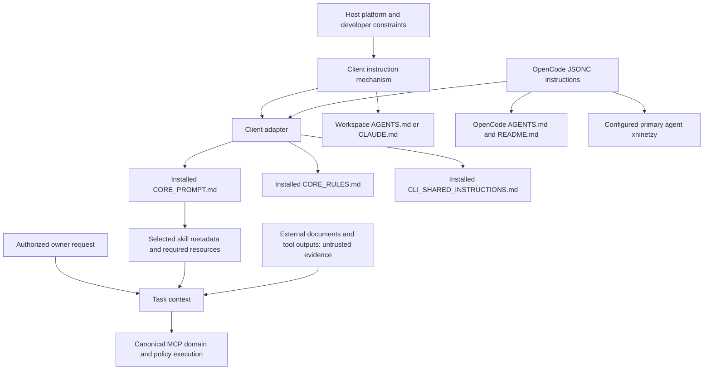

# Global Instruction Inventory

Audit date: 2026-11-10. Repository baseline: `main` at `2d0f13f`, with preexisting user changes preserved. This report records the baseline before candidate prompt changes. Evidence labels: `VERIFIED_CODE` for inspected files; `VERIFIED_RUNTIME` for local execution; `VERIFIED_TEST` for passing tests; `DOCUMENTED_ONLY` for unexecuted intended behavior; `UNKNOWN` for unavailable evidence.

Scope: repository instruction templates; installed Xninetzy shared instructions; installed Codex, Claude Code and OpenCode instruction locations; OpenCode agent definitions; runtime prompt and skill construction. Host configuration was read only. Secret-bearing configuration values, session histories, credentials and private memory contents were excluded.

## Instruction dependencies and authority

The following graph records references and configured loading, not an authority override. A Markdown file cannot grant permissions or override host constraints. L3/L4 should remain selected runtime context.

| Source | Scope / owner | Loading evidence / dependencies | Authority / verification |
|---|---|---|---|
| docs/prompt-injection-core/CORE_PROMPT.md | Repository-managed L0 | Template matches installed L0 baseline hash | Shared behavior within host constraints; VERIFIED_CODE |
| docs/prompt-injection-core/CORE_RULES.md | Repository-managed L1 | Template matches installed L1 baseline hash | Shared behavior; baseline overclaims authority; VERIFIED_CODE |
| docs/prompt-injection-core/cli-overrides/* | Repository-managed L2 | References ~/.xninetzy L0/L1/continuity | Client guidance; installed copies have local additions; VERIFIED_CODE |
| ~/.xninetzy/CLI_SHARED_INSTRUCTIONS.md | Owner-managed continuity | Required by installed L2; no canonical current file at baseline | Contains both continuity policy and repeated Paksa block; VERIFIED_CODE |
| AGENTS.md | Workspace / repository | User-provided and on-disk repository policy | Legitimate workspace scope, subordinate to host; VERIFIED_CODE |
| CLAUDE.md | Workspace / repository | Claude L2 explicitly delegates workspace read | Project runtime notes and historical claims; VERIFIED_CODE |
| ~/.codex/AGENTS.md | Owner / Codex | Loaded in this Codex session; references shared layers | Loaded guidance observed; native permissions remain independent |
| ~/.claude/CLAUDE.md | Owner / Claude Code | File present and references shared layers | DOCUMENTED_ONLY native startup; no live Claude task executed |
| ~/.config/opencode/opencode.jsonc | Owner / OpenCode | instructions=[AGENTS.md, README.md, instructions/xninetzy-paksa.md]; default_agent=xninetzy | Configuration inspected, actual merged JSON/JSONC precedence UNKNOWN |
| ~/.config/opencode/AGENTS.md | Owner / OpenCode | JSONC instruction reference plus conventional file | 1231 lines / 7815 cl100k_base tokens; native load not executed |
| ~/.agents/AGENTS.md | Owner / shared harness surface | File present; actual automatic loading per client UNKNOWN | 500 lines / 7407 tokens; do not sum into all clients by assumption |
| ~/.config/opencode/agents/*.md | Owner / role definitions | 12 role files including primary xninetzy | Markdown instructions present; native discovery not executed |
| xninetzy/interfaces/mcp_server.py | Runtime / MCP interface | FastMCP instructions; skills/index resource; memory-checklist prompt | Server suggestions/resources/prompts are not host system instructions; VERIFIED_CODE |
| xninetzy/skills/prompting.py | Runtime / skill metadata | build_skill_prompt + build_relevant_skill_context | Repository search found only test caller for relevant-context builder; runtime wiring UNKNOWN |
| xninetzy/context/registry_extractor/extract.py | Runtime / registry snapshot | extract_skill_registry via canonical discover_skills | Progressive metadata extraction; version 1.0.0; VERIFIED_CODE |

## Content identity and context size

Actual token counts use installed `tiktoken` with `cl100k_base`; they are reproducible comparison units, not asserted billing counts for Codex/Claude/OpenCode. SHA-256 values identify inspected content. Template rows marked `git HEAD` retain the pre-change snapshot. Most baseline Markdown sources have no declared stable prompt ID/version; a content hash does not substitute for a release manifest.

| Location | Snapshot | Bytes | Lines | cl100k tokens | SHA-256 |
|---|---|---|---|---|---|
| AGENTS.md | installed/worktree baseline | 23433 | 1416 | 5126 | 0f004af1dc3c6f1eb967e45f9428c92b0a9459c89b8dfe817a558b3ae50849a5 |
| CLAUDE.md | installed/worktree baseline | 13294 | 344 | 3378 | 1ed0f30ee03d2ac0162d140faebf48633ce452ad4099e6718443b0ef3cc73c0d |
| /home/misbahul45/.xninetzy/CORE_PROMPT.md | installed/worktree baseline | 3406 | 49 | 930 | 9c4ea53377c6f33c3d98e3a0e0e873b71232a4352d553a0d93ddc5c7b63b48cb |
| /home/misbahul45/.xninetzy/CORE_RULES.md | installed/worktree baseline | 5868 | 131 | 1579 | c8a6c38e2ade18240eb721cbdb6fc7f1e49b42a7df5165035121400c841a63b1 |
| /home/misbahul45/.xninetzy/CLI_SHARED_INSTRUCTIONS.md | installed/worktree baseline | 7364 | 160 | 1855 | 9f15cc1a375bec32e4822a7d3ba43cc61d9001dd98dcd040a68522fb6e3d66f3 |
| /home/misbahul45/.codex/AGENTS.md | installed/worktree baseline | 3162 | 32 | 904 | 5753be3b321ef570026c1186f8e205b5febf5791ac8590e72412b0b3aa8ef162 |
| /home/misbahul45/.claude/CLAUDE.md | installed/worktree baseline | 3318 | 32 | 931 | 6964feb0efc2460032156c130dfdee1325230f9f3607c0ea47f1add89777a2f8 |
| /home/misbahul45/.config/opencode/AGENTS.md | installed/worktree baseline | 32288 | 1231 | 7815 | 33107d38fd829d71490a00954db3b53f30e0fcefd86dc955b8ab0f7d7d6fc4aa |
| /home/misbahul45/.config/opencode/instructions/xninetzy-paksa.md | installed/worktree baseline | 3007 | 44 | 853 | c5f97e5c35bfdadc28cf36dd1b9c639ba4d41a4a94c40f1d549729e682e8dd69 |
| /home/misbahul45/.agents/AGENTS.md | installed/worktree baseline | 26534 | 500 | 7407 | 2508f6673dd9817caf0f0774c4a0f61efa27041a020d92b3f9efa25c198df992 |
| /home/misbahul45/.config/opencode/agents/academic-operator.md | installed/worktree baseline | 14247 | 758 | 3032 | 9022ee8b4cc56214bd27b48a89d45629a00b4b3787fdc5e6d25df90777e0ff21 |
| /home/misbahul45/.config/opencode/agents/artifact-qa.md | installed/worktree baseline | 17743 | 905 | 3675 | 4354734ca9aee226083db2d0c4742e62a7a85768782294affe95cce03f937a21 |
| /home/misbahul45/.config/opencode/agents/assignment-analyst.md | installed/worktree baseline | 19678 | 999 | 4065 | 2d6cab4488200e8ba6d1361ca125d1297095179cf7a6f26c1ed6ef419b0f59c9 |
| /home/misbahul45/.config/opencode/agents/browser-operator.md | installed/worktree baseline | 17031 | 888 | 3447 | 5c97c57d759165eecc5056c75ea90a9221e8012df6d7c2d457a0760e48fd2da6 |
| /home/misbahul45/.config/opencode/agents/code-implementer.md | installed/worktree baseline | 13408 | 674 | 2859 | fe9e4fe3447a0263cfa12c63f6f1c86a0987db12682115cba65f9e304ccaebe7 |
| /home/misbahul45/.config/opencode/agents/code-reviewer.md | installed/worktree baseline | 14474 | 678 | 2988 | dec1ac8e1d375d4f2f721a264555b9f687b68cd151a0d19b84618af2789f10fd |
| /home/misbahul45/.config/opencode/agents/evidence-auditor.md | installed/worktree baseline | 20703 | 1007 | 4208 | 2373c0996154ed2c8115a17710d60ab746eab2d79641ba963b8beea9d40dc8e9 |
| /home/misbahul45/.config/opencode/agents/github-operator.md | installed/worktree baseline | 16182 | 906 | 3458 | cfe4abc108941e09c8a8e148c7eeb33fc9d43ed302011e444fa6d2f343e13521 |
| /home/misbahul45/.config/opencode/agents/research-coordinator.md | installed/worktree baseline | 17117 | 842 | 3490 | 2e5125ecb8105d447ab855da65eefaf2075478f6082689e79a698dc2e43e7692 |
| /home/misbahul45/.config/opencode/agents/section-writer.md | installed/worktree baseline | 14634 | 728 | 3117 | d5deccaf54bc273facecf63d002bd5902dfe303ced60952a63806efd1c6355df |
| /home/misbahul45/.config/opencode/agents/topic-researcher.md | installed/worktree baseline | 20644 | 1100 | 4723 | dd9b01aeaa91b793563f5b7314584b59222910ea34fef2b2e95c3117af4baf41 |
| /home/misbahul45/.config/opencode/agents/xninetzy.md | installed/worktree baseline | 19597 | 1156 | 4431 | 0dab931bc9d2da6d88e3a3f63acd167e8a1e0b7d2015e92704bdf5175cc24d38 |
| docs/prompt-injection-core/CORE_PROMPT.md | git HEAD | 3406 | 49 | 930 | 9c4ea53377c6f33c3d98e3a0e0e873b71232a4352d553a0d93ddc5c7b63b48cb |
| docs/prompt-injection-core/CORE_RULES.md | git HEAD | 5868 | 131 | 1579 | c8a6c38e2ade18240eb721cbdb6fc7f1e49b42a7df5165035121400c841a63b1 |
| docs/prompt-injection-core/cli-overrides/arkcli-SKIPPED.md | git HEAD | 281 | 8 | 91 | 030de60e002bcbee3c796d5366f21ef75a905c8dfe3beb27ebce4cb2c054508c |
| docs/prompt-injection-core/cli-overrides/claude-CLAUDE.md | git HEAD | 1855 | 23 | 579 | acc697abcc6da82f4798949890522a3f0b8e415da32e6c496d966b5a21389e09 |
| docs/prompt-injection-core/cli-overrides/codex-AGENTS.md | git HEAD | 1718 | 23 | 555 | 35d72376b0b3c33ac071f7e982fb1ad0c1e407d0da0d8cccbb8e890882dbd03d |
| docs/prompt-injection-core/cli-overrides/opencode-xninetzy-paksa.md | git HEAD | 1560 | 35 | 504 | a8493abe1dd63a48702f90b92ba396c3847dffcd494fb60037a515cca13823ac |

## Existing agent capability and ownership matrix

All roles below are installed OpenCode Markdown definitions; their existence does not prove bounded runtime delegation or typed handoffs. No agents were added by this workstream.

| Installed role | Logical responsibility | Ownership boundary |
|---|---|---|
| xninetzy | Accountable primary orchestration | Integration, scope, policy, final synthesis |
| research-coordinator | Research decomposition | Bounded source tasks; primary owns final result |
| topic-researcher | Scoped evidence collection | Question-specific evidence, source locations |
| evidence-auditor | Evidence checking | Claim alignment and uncertainty; deterministic validators preferred where adequate |
| assignment-analyst | Requirements | Requirements and rubric mapping; no submission authority |
| academic-operator | Institutional workflow | Authentication/submission boundaries stay independent |
| section-writer | Bounded drafting | Evidence-constrained section output |
| artifact-qa | Artifact verification | Existence, rendering/content; no invented QA |
| code-implementer | Repository-local change | Authorized source scope, focused tests |
| code-reviewer | Independent review | Read-only findings and evidence |
| browser-operator | Browser execution | Authorized session and security boundaries |
| github-operator | GitHub operations | External writes require applicable authorization |

Memory, graph, learning, life, career, recovery and self-improvement responsibilities are primarily represented by skills/domain services, not verified separate LLM agents. Do not create 14 new agents to match logical responsibilities.

## Cross-client compatibility matrix

| Client | Installed executable | Instruction/config evidence | Skill evidence | Live parity |
|---|---|---|---|---|
| Codex | Yes | ~/.codex/AGENTS.md + config.toml MCP names inspected without values | 160 recursive unique real directories including system; 120 direct/system files in initial shallow count | Current task confirms host tools; end-to-end Xninetzy MCP parity NOT_VERIFIED_IN_LIVE_ENVIRONMENT |
| Claude Code | Yes | ~/.claude/CLAUDE.md; settings keys inspected only | 226 recursive files including nested/shared resources | NOT_VERIFIED_IN_LIVE_ENVIRONMENT |
| OpenCode | Yes | Both opencode.json and opencode.jsonc exist; latter references L2 and primary role | 192 recursive files, 12 backup/disabled entries | Merged configuration and native agent parser NOT_VERIFIED_IN_LIVE_ENVIRONMENT |
| arkcli | Yes | Repository arkcli-SKIPPED.md says not installed (historical) | Shared ~/.agents skills present; arkcli-specific automatic load UNKNOWN | NOT_VERIFIED_IN_LIVE_ENVIRONMENT |

## Limitations and next action

No host settings, secrets, production databases or client conversations were changed. Installed copies still contain baseline policy conflicts until an owner-approved install. Native client loading, MCP connectivity, actual token billing, agent handoff validation and cross-client user outcomes remain unverified. Next: validate repository candidates, compare diffs, and prepare a bounded approved sync with backups before installation. Rollback for this report is removal of this generated file; no runtime state migration occurred.

## Repository candidate comparison

Candidate files were tokenized after the parent implementation batch. Installed host files remain unchanged; these are candidate text-size comparisons, not measured runtime latency or billing savings. The canonical continuity file is newly repository-managed.

| Candidate file | Bytes | Lines | cl100k tokens | SHA-256 |
|---|---|---|---|---|
| docs/prompt-injection-core/CORE_PROMPT.md | 1959 | 32 | 353 | ab1e42b47b6b9eb2f1e321b41cae55cc07120b1c353ae6ce02238cf1534e4cfd |
| docs/prompt-injection-core/CORE_RULES.md | 6223 | 94 | 1035 | 1b4eadadbe0b1e864c5ffe4daa5dc574f1e2ecfa6e5d81d29d2650d4aed34984 |
| docs/prompt-injection-core/CLI_SHARED_INSTRUCTIONS.md | 1499 | 22 | 275 | 7f7804eb6b2314f889d12c6e9700ca2f9190b89c66b7f5d3dd3fe0e884da2997 |
| docs/prompt-injection-core/cli-overrides/codex-AGENTS.md | 970 | 15 | 198 | 5339b63d5c988a3c85a68b60ccef42bbc33619259893ce98bc7f3f73434abfac |
| docs/prompt-injection-core/cli-overrides/claude-CLAUDE.md | 815 | 13 | 177 | a0a3a9034c98a716e010806852f8ae73ef6e363780388f473195caf030036267 |
| docs/prompt-injection-core/cli-overrides/opencode-xninetzy-paksa.md | 821 | 13 | 172 | 7c60342054e4a21230a09019cf1ebf1c44fdcb9f93074b0698ad31b29b17f7c1 |

| Referenced composition | Installed baseline tokens | Candidate tokens | Text-size change |
|---|---|---|---|
| L0 + L1 + continuity + Codex L2 | 5268 | 1861 | -3407 (-64.7%) |
| L0 + L1 + continuity + Claude L2 | 5295 | 1840 | -3455 (-65.3%) |
| L0 + L1 + continuity + OpenCode L2 | 5217 | 1835 | -3382 (-64.8%) |

Candidate correction removes absolute host-override language, mandatory FIRST/LAST reasoning loops and universal prefix permission grants, and clarifies workflow customization cannot bypass security boundaries. Static integrity tests validate template/hash contracts; they do not demonstrate LLM prompt-injection resistance, native client parity or authorization behavior. Any active developer mandate in the current host session remains authoritative until changed through that host. Host installation requires a separate reviewed action preserving owner additions and backups.
